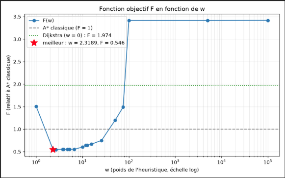
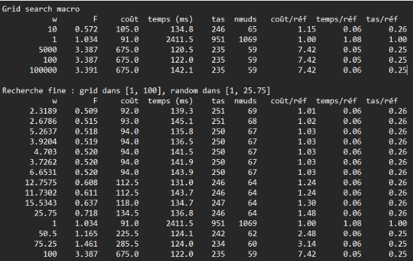

# IA Calculability

Recherche de chemin sur une grille avec plusieurs algorithmes (BFS, DFS, Greedy, Dijkstra, A*, A* pondérée).

## Commandes

```bash
# 1. Lancer l'API de la grille (Docker, port 8000)
bash ./grid/launch.sh

# 2. Générer une grande grille aléatoire (taille, densité d'obstacles, seed)
python ./agent/src/generate_grid.py --size 60 --density 0.25 --seed 42

# 3. Lancer l'agent (algorithme choisi dans main.py)
python ./agent/src/main.py

# 4. Comparer tous les algorithmes (nœuds, temps, coût)
python ./agent/src/compare.py

# 5. Chercher le meilleur poids w de l'A* pondérée -> results.csv
python ./agent/src/optimize.py

# 6. Tracer F en fonction de w -> results.png
python ./agent/src/plot_results.py

# 7. Tester w sur plusieurs grilles différentes -> robustness.csv
python ./agent/src/robustness.py
```

**Groupe 1 :**
Joel FERNANDES
Mohamed EL OUABHI
Firmin SHU
Romain MAURICE

---

## Consigne TP

- Modelisation du probleme sous forme de contraintes -> choix et raisons.
- Resolution du probleme d'optimisation sur configuration fixe (configuration par defaut) -> presentation de la solution, des raisons et analyse des resultats (pourquoi vous avez ces resultats? qu'est-ce que ca donne de modifier la function de cout, les parametres de recherche? Quelle strategie employee? Quelles sont les avantages et les inconvenients d'une telle recherche?)
- Prendre la solution trouvee et la tester sur une configuration variable. Qu'est-ce que ca donne? Comment les resultats variant? Pourquoi?
- Quelles solutions proposez-vous pour gerer la recherche de parametres (a, b, c, w, h) lorsque la configuration change?

---

## 1. Modelisation du probleme sous forme de contraintes

**Fonction A star pondérée :** `g(n) + w * h(n)`

**Fonction objectif :**

```
F(w, h) = a · Coût/Coût_réf  +  b · Temps/Temps_réf  +  c · Mémoire/Mémoire_réf
```

(avec ref qui sont les valeurs de A\* w=1)

- **Variable de décision:** w,h
- **Contrainte :** somme des poids du chemins <= threshold, h admissible, temps, mémoire, coût, efficacité <= coût optimal.
- **Hyperparamètres :** grille, connectivité n, obstacles, threshold, origine, cible
- **Espace de solution faisable :** (Grille - contrainte)
- **Solution optimal :** résultat fonction objectif le plus haut en respectant les contraintes

**Trouver le chemin avec :**

- le coût le plus faible
- le temps le plus court
- la plus petite utilisation de mémoire

---

## 2. Résolution du problème d'optimisation sur configuration fixe

**Configuration par défaut :**

rappel : `F = a*coût réel + b*temps réel + c*mémoire réel`

**Parts de F arbitraire :** coût 45%, temps 45%, mémoire 10%

On cherche dans la fonction F un w qui privilégie le temps et le coût au détriment de la mémoire. Changer ses valeurs de donnera pas le même meilleur w car le problème sera différent

**h = euclidien :** car elle est admissible en connectivité 8

### 2.1 Stratégie de recherche

Recherche en trois temps:

1. Grid search macro sur des valeurs exponentielles w ∈ {0, 1, 10, 100, 5000, 100000} : repérer les grandes zones.
2. Grid search fin dans la plage entourant le meilleur point du macro (ici meilleur point = 10 donc  [1, 100]).
3. Random search resserré (20 tirages) dans une plage resserrée une seconde fois autour du meilleur point trouvé

(Autre solution, remplacer le Random search par un hill climbing sur la fenêtre resserrée afin de trouver le meilleur w dans la plage).

### 2.2 Solution

**w ≈ 2,3 (F = 0,546)**, avec une zone équivalente w ∈ [2,3 ; 6,7] (F entre 0,546 et 0,554).





**Analyse des résultats :**

- Si F = 1, alors la F(w) se comporte comme A\* w=1
- Si F < 1, alors la fonction donne de meilleur résultat que A\* w=1
- Si F > 1 alors la fonction donne de moins bons résultat que A\* w=1

On voit dans le graphique que la fonction d’objectif explose à w > 100. On observe un puits dans l'intervalle [1,10]. On en déduit que le w optimal, qui minimise F(w) se situe dans cet interval

---

## 3. Sur des grilles différentes avec w trouvé précédemment

On teste w = 2,32 (trouvé sur la configuration fixe) sur 18 configurations :

- tailles : 30×30, 60×60, 80×80
- densités d'obstacles : 10 %, 25 %, 40 % avec des poids entre 2 et 40
- 2 seeds. pour placer aléatoirement les obstacles de deux façons différentes

Pour chaque configuration, la référence est A\* classique mesuré sur cette configuration

La solution w = 2,32 se généralise bien.Elle bat A\* w = 1 sur les 18 configurations. On constate aussi que plus la grille est grande, plus le gain de F est grand.
Par contre quand

---

## 4. recherche de paramètres sur changement de configuration

- **Pour w** si la configuration change, repartir de l’ancien w et appliquer le hill climbing pour trouver un voisin proche et rester dans le puits s’il le nouveau “meilleur” w est proche. Si le meilleur nouveau w est trop éloigné, dans ce cas il vaut mieux repartir à la recherche complète.
- **Pour a, b et c**, il n’y a pas de solutions génériques et cela dépend des contraintes techniques du projet. Est ce qu’on le résultat doit être le plus rapide possible, dans ce cas privilégier B ; Est ce que le calcul doit se faire sur une machine ayant une mémoire basse et limitée, alors privilégier C. Si seul le chemin le plus court compte alors A est la priorité.
- **Pour h**, cela dépend de la connectivité : pour une connectivité 4, Manhattan est plus admissible et plus précis. tandis que pour la connectivité 8, dans ce cas Manhattan surestime les diagonales et donc il vaut mieux choisir euclidienne
